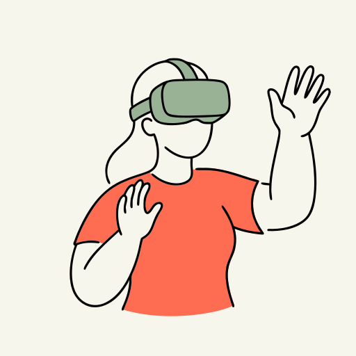
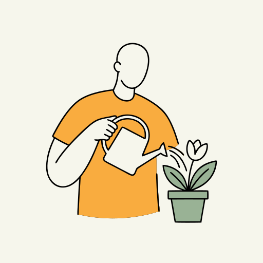
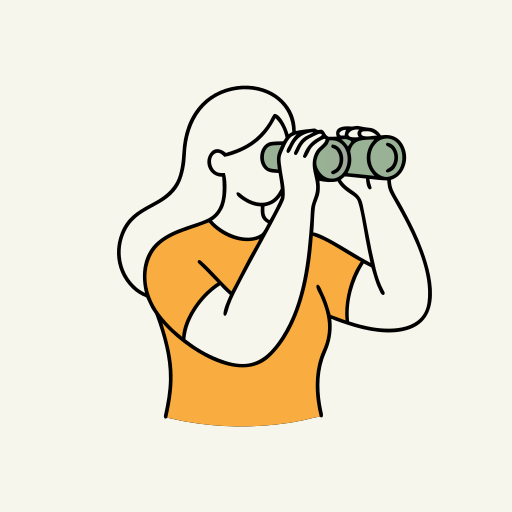
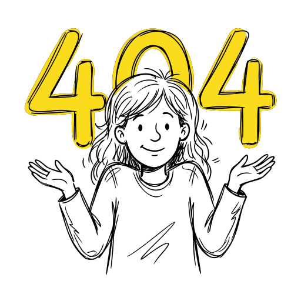
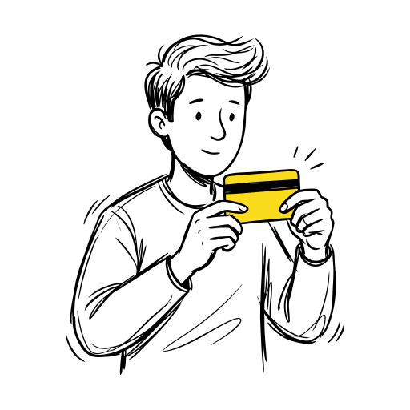
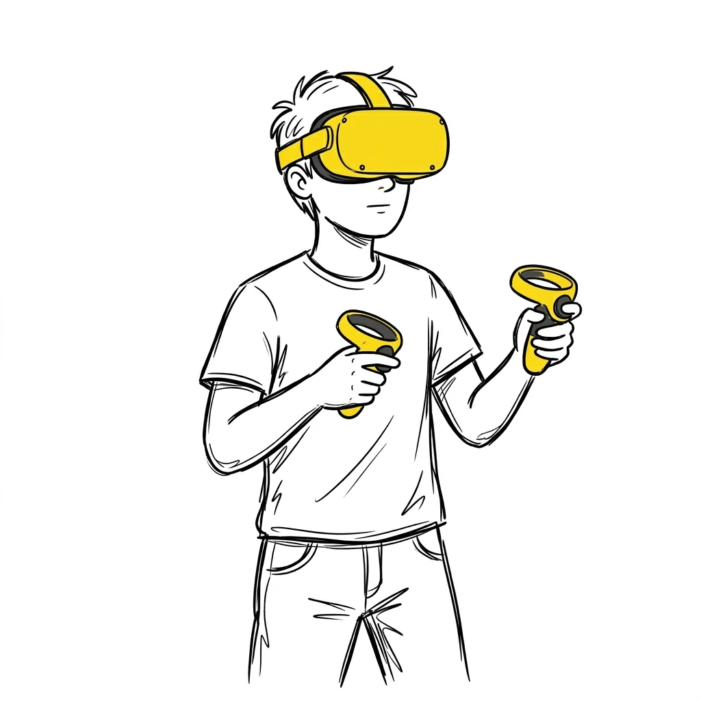
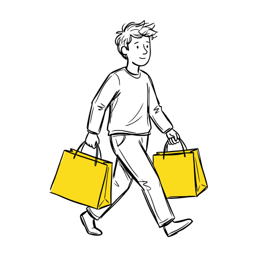

# Artifisio Illustrations

**[Browse the gallery → artifisio.github.io/illustrations](https://artifisio.github.io/illustrations/)**

27 sets, 541 open-licensed illustrations. Every SVG is themeable through CSS variables; recolour a set, then install it with one command.

## Featured

<table>
<tr>
<td align="center" valign="top" width="33%">
<a href="sets/strawhat"></a><br />
&nbsp;&nbsp;
<br /><br />
<strong><a href="sets/strawhat">Strawhat</a></strong><br />
<sub>16 illustrations · SVG · WEBP</sub><br /><br />
<code>npx artifisio add strawhat</code>
</td>
<td align="center" valign="top" width="33%">
<a href="sets/duck"></a><br />
&nbsp;&nbsp;
<br /><br />
<strong><a href="sets/duck">duck</a></strong><br />
<sub>9 illustrations · SVG · WEBP</sub><br /><br />
<code>npx artifisio add duck</code>
</td>
<td align="center" valign="top" width="33%">
<a href="sets/surreality"></a><br />
&nbsp;&nbsp;
<br /><br />
<strong><a href="sets/surreality">Surreality</a></strong><br />
<sub>12 illustrations · SVG · WEBP · 3 themeable colours</sub><br /><br />
<code>npx artifisio add surreality</code>
</td>
</tr>
<tr>
<td align="center" valign="top" width="33%">
<a href="sets/allanpoe"></a><br />
&nbsp;&nbsp;
<br /><br />
<strong><a href="sets/allanpoe">allanpoe</a></strong><br />
<sub>8 illustrations · SVG · WEBP</sub><br /><br />
<code>npx artifisio add allanpoe</code>
</td>
<td align="center" valign="top" width="33%">
<a href="sets/illustrations-61177"></a><br />
&nbsp;&nbsp;
<br /><br />
<strong><a href="sets/illustrations-61177">kawaii</a></strong><br />
<sub>14 illustrations · SVG · WEBP</sub><br /><br />
<code>npx artifisio add illustrations-61177</code>
</td>
<td align="center" valign="top" width="33%">
<a href="sets/unicorn-life"></a><br />
&nbsp;&nbsp;
<br /><br />
<strong><a href="sets/unicorn-life">Unicorn Life</a></strong><br />
<sub>14 illustrations · SVG · WEBP · 3 themeable colours</sub><br /><br />
<code>npx artifisio add unicorn-life</code>
</td>
</tr>
<tr>
<td align="center" valign="top" width="33%">
<a href="sets/simple-people"></a><br />
&nbsp;&nbsp;
<br /><br />
<strong><a href="sets/simple-people">Simple People</a></strong><br />
<sub>19 illustrations · SVG · WEBP · 3 themeable colours</sub><br /><br />
<code>npx artifisio add simple-people</code>
</td>
<td align="center" valign="top" width="33%">
<a href="sets/scribble-people"></a><br />
&nbsp;&nbsp;
<br /><br />
<strong><a href="sets/scribble-people">scribble-people</a></strong><br />
<sub>20 illustrations · SVG · WEBP · 1 themeable colour</sub><br /><br />
<code>npx artifisio add scribble-people</code>
</td>
<td align="center" valign="top" width="33%">
<a href="sets/sumi-e-ink"></a><br />
&nbsp;&nbsp;
<br /><br />
<strong><a href="sets/sumi-e-ink">Sumi-e Ink</a></strong><br />
<sub>9 illustrations · SVG · WEBP</sub><br /><br />
<code>npx artifisio add sumi-e-ink</code>
</td>
</tr>
</table>

## All sets (27)

| Set | Slug | Details | Tags |
| --- | ---- | ------- | ---- |
| [Zenithglade](sets/zenithglade) | `zenithglade` | 32 illustrations · SVG · WEBP · 7 themeable colours |  |
| [Orbitab](sets/orbitab) | `orbitab` | 33 illustrations · SVG · WEBP · 4 themeable colours |  |
| [Fernforge](sets/fernforge) | `fernforge` | 25 illustrations · SVG · WEBP · 4 themeable colours |  |
| [Lumenaut](sets/lumenaut) | `lumenaut` | 35 illustrations · SVG · WEBP · 5 themeable colours |  |
| [Voltweave](sets/voltweave) | `voltweave` | 33 illustrations · SVG · WEBP · 2 themeable colours |  |
| [Fresh sourdough](sets/fresh-sourdough) | `fresh-sourdough` | 15 illustrations · SVG · WEBP · 4 themeable colours |  |
| [Rooftop garden](sets/rooftop-garden) | `rooftop-garden` | 36 illustrations · SVG · WEBP |  |
| [deoxyribonucleic](sets/deoxyribonucleic) | `deoxyribonucleic` | 36 illustrations · SVG · WEBP |  |
| [Bio astronaut](sets/bio-astronaut) | `bio-astronaut` | 36 illustrations · SVG · WEBP |  |
| [Urban delivery](sets/urban-delivery) | `urban-delivery` | 33 illustrations · SVG · WEBP |  |
| [Sumi-e Ink](sets/sumi-e-ink) | `sumi-e-ink` | 9 illustrations · SVG · WEBP |  |
| [Geometric City](sets/geometric-city) | `geometric-city` | 10 illustrations · SVG · WEBP · 3 themeable colours |  |
| [Lakeside Yoga](sets/lakeside-yoga) | `lakeside-yoga` | 18 illustrations · SVG · WEBP · 4 themeable colours |  |
| [Sustainable](sets/sustainable) | `sustainable` | 9 illustrations · SVG · WEBP · 3 themeable colours |  |
| [Simple People](sets/simple-people) | `simple-people` | 19 illustrations · SVG · WEBP · 3 themeable colours |  |
| [scribble-people](sets/scribble-people) | `scribble-people` | 20 illustrations · SVG · WEBP · 1 themeable colour |  |
| [bottle-herb](sets/bottle-herb) | `bottle-herb` | 27 illustrations · SVG · WEBP · 2 themeable colours |  |
| [animals-paper](sets/animals-paper) | `animals-paper` | 9 illustrations · SVG · WEBP | papercut, animals, 3d |
| [Appliances-1930s](sets/appliances-1930s) | `appliances-1930s` | 9 illustrations · SVG · WEBP | rubber-hose, vintage, cartoon |
| [neoclassic-street-art](sets/neoclassic-street-art) | `neoclassic-street-art` | 13 illustrations · SVG · WEBP · 3 themeable colours | street-art, classical, neon |
| [Insects Art Nouveau](sets/insects-art-nouveau) | `insects-art-nouveau` | 11 illustrations · SVG · WEBP | art-nouveau, insects, vintage |
| [Unicorn Life](sets/unicorn-life) | `unicorn-life` | 14 illustrations · SVG · WEBP · 3 themeable colours |  |
| [Surreality](sets/surreality) | `surreality` | 12 illustrations · SVG · WEBP · 3 themeable colours |  |
| [Strawhat](sets/strawhat) | `strawhat` | 16 illustrations · SVG · WEBP |  |
| [duck](sets/duck) | `duck` | 9 illustrations · SVG · WEBP | sticker, cute, animals |
| [allanpoe](sets/allanpoe) | `allanpoe` | 8 illustrations · SVG · WEBP |  |
| [kawaii](sets/illustrations-61177) | `illustrations-61177` | 14 illustrations · SVG · WEBP | kawaii, chibi, characters |

Each set folder has a README, its files and a `meta.json` with the sha256 of every file.

## Install

```bash
# Find a set
npx artifisio search "<vibe>" --kind illustration

# Add it to your project (files + ATTRIBUTION.md)
npx artifisio add <set>

# Pick formats
npx artifisio add <set> --format svg,png,webp,jpg

# Apply brand colours at install time
npx artifisio add <set> --colors "primary=#4A7CFF,secondary=#FF6B35"

# Update installed sets
npx artifisio update <set>
```

`add` pins each set's registry `version` and `manifestHash` in `.artifisiorc.json` for reproducible installs. It also generates a typed `index.ts`, so illustrations import as constants.

## File URLs

```
https://raw.githubusercontent.com/artifisio/illustrations/main/sets/<set>/svg/<illustration>.svg
```

Swap `main` for a release tag such as `v2026.10.27-2116-36700ff` to pin it. Prefer these over jsDelivr, which can refuse this repo because of its size.

## Theming

Every set names its colour slots, exposed as CSS variables on the SVG root (`--artf-primary`, `--artf-secondary`, …), so illustrations follow your brand without editing files:

```css
svg { --artf-primary: #4A7CFF; }
```

Or set them at install time, optionally baked into the fills so no runtime CSS is needed:

```bash
npx artifisio add <set> --colors "primary=#4A7CFF" --bake
```

## License

All illustrations here are licensed under [CC BY 4.0](LICENSE): use them commercially, modify them and redistribute them, keeping the credit. Attribution text lives in every set's `license.attribution`; `npx artifisio add` writes it to `ATTRIBUTION.md` for you.

## Registry details

| Field | Value |
| --- | --- |
| Registry version | `2026.10.27-2116-36700ff` |
| CLI | [`artifisio`](https://www.npmjs.com/package/artifisio) |
| License | [CC BY 4.0](LICENSE) |
| Other kinds | [`index.json`](index.json) lists every per-kind registry (icons, fonts) |
| For agents | [`llms.txt`](llms.txt) |

Generated and curated at [artifisio.com](https://artifisio.com) and published by its sync pipeline: pull requests get overwritten, so please [open an issue](../../issues) instead.
