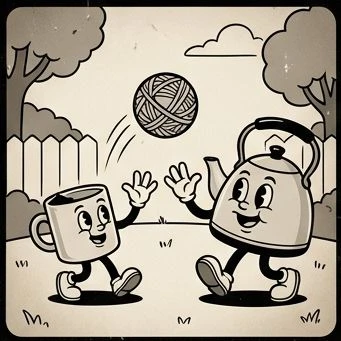
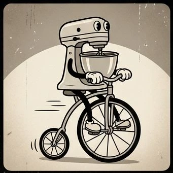
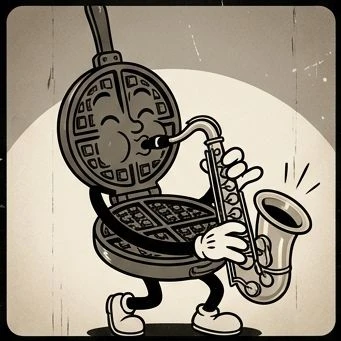
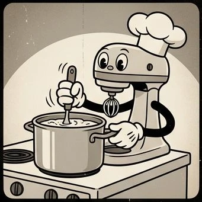

# Appliances-1930s

**[Open in the gallery →](https://artifisio.github.io/illustrations/appliances-1930s/)**

Kitchen appliances as 1930s rubber-hose cartoon characters — noodle limbs, white gloves, pie eyes, sepia grain and film scratches.

<p>
<a href="https://artifisio.github.io/illustrations/appliances-1930s/"></a>
<a href="https://artifisio.github.io/illustrations/appliances-1930s/"></a>
<a href="https://artifisio.github.io/illustrations/appliances-1930s/"></a>
<a href="https://artifisio.github.io/illustrations/appliances-1930s/"></a>
</p>

9 illustrations · SVG · WEBP · [CC-BY-4.0](https://creativecommons.org/licenses/by/4.0/)

## Install

```bash
npx artifisio add appliances-1930s
```

---

Part of the [Artifisio illustrations registry](../../README.md). Credit: Illustrations by Artifisio (https://artifisio.com); `add` writes it to `ATTRIBUTION.md`. `meta.json` lists every file with its sha256.
