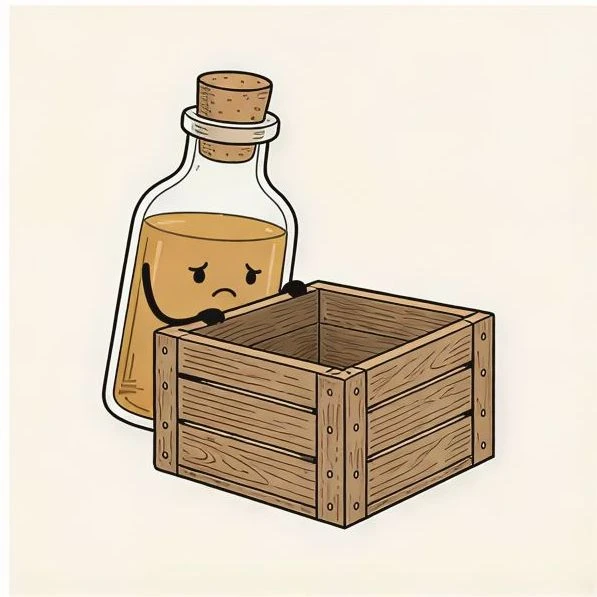
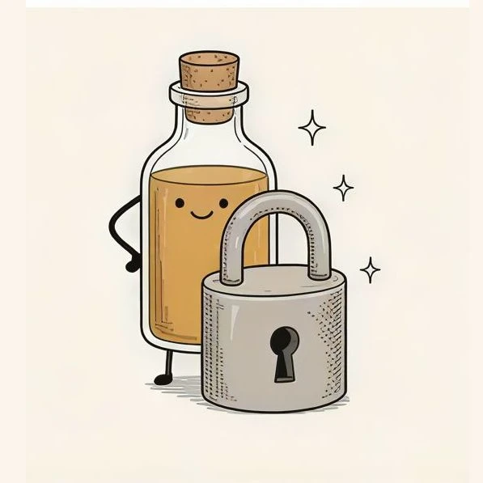
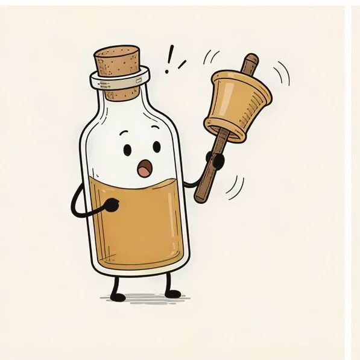
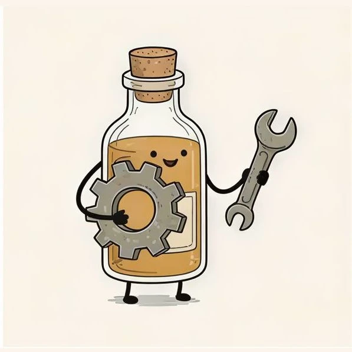

# bottle-herb

**[Open in the gallery →](https://artifisio.github.io/illustrations/bottle-herb/)**

Infuse your creative projects with a sense of wonder using this charming glass bottle character that brings a tiny, herbal world to life. These whimsical illustrations are perfect for adding a touch of magic to your stationery, branding, or digital journals. You will love how each expressive pose sparks joy and captures the imagination of your audience instantly.

<p>
<a href="https://artifisio.github.io/illustrations/bottle-herb/"></a>
<a href="https://artifisio.github.io/illustrations/bottle-herb/"></a>
<a href="https://artifisio.github.io/illustrations/bottle-herb/"></a>
<a href="https://artifisio.github.io/illustrations/bottle-herb/"></a>
</p>

27 illustrations · SVG · WEBP · 2 themeable colours · [CC-BY-4.0](https://creativecommons.org/licenses/by/4.0/)

## Install

```bash
npx artifisio add bottle-herb
```

Recolour at install time; themeable slots: `primary`, `accent`.

```bash
npx artifisio add bottle-herb --colors "primary=#4A7CFF"
```

---

Part of the [Artifisio illustrations registry](../../README.md). Credit: Illustrations by Artifisio (https://artifisio.com); `add` writes it to `ATTRIBUTION.md`. `meta.json` lists every file with its sha256.
