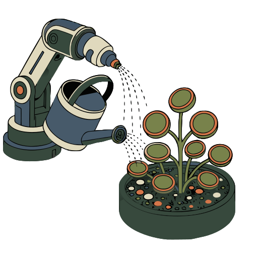
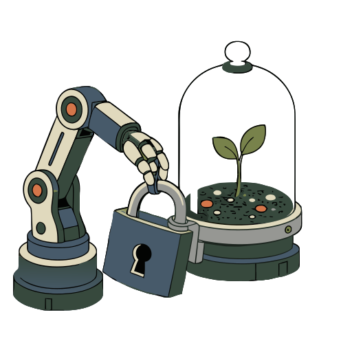
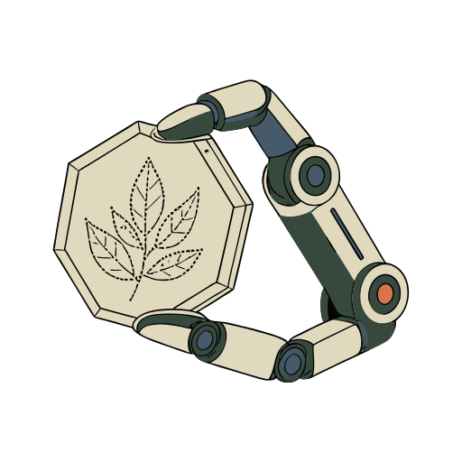

# Fernforge

**[Open in the gallery →](https://artifisio.github.io/illustrations/fernforge/)**

Transform your designs with a serene vision of technology and nature working in perfect, nurturing harmony as mechanical arms tend to delicate succulents. You will find endless inspiration in these gentle guardians that bring a sense of quiet wonder and modern tranquility to your digital or physical spaces. This collection is the perfect choice for infusing your branding or decor with a unique atmosphere of care and futuristic peace.

<p>
<a href="https://artifisio.github.io/illustrations/fernforge/"></a>
<a href="https://artifisio.github.io/illustrations/fernforge/"></a>
<a href="https://artifisio.github.io/illustrations/fernforge/"></a>
<a href="https://artifisio.github.io/illustrations/fernforge/"></a>
</p>

25 illustrations · SVG · WEBP · 4 themeable colours · [CC-BY-4.0](https://creativecommons.org/licenses/by/4.0/)

## Install

```bash
npx artifisio add fernforge
```

Recolour at install time; themeable slots: `primary-blue`, `secondary-teal`, `leaf-green`, `accent-orange`.

```bash
npx artifisio add fernforge --colors "primary-blue=#4A7CFF"
```

---

Part of the [Artifisio illustrations registry](../../README.md). Credit: Illustrations by Artifisio (https://artifisio.com); `add` writes it to `ATTRIBUTION.md`. `meta.json` lists every file with its sha256.
