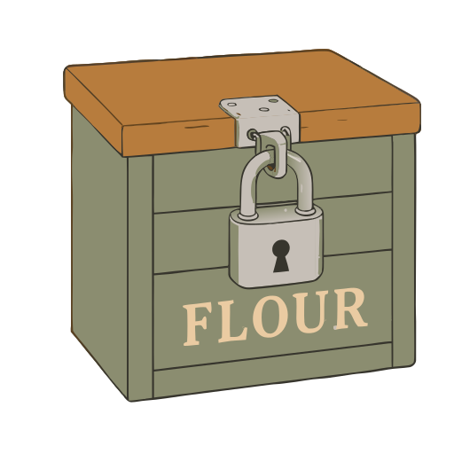

# Fresh sourdough

**[Open in the gallery →](https://artifisio.github.io/illustrations/fresh-sourdough/)**

Bring the warmth of a sun-drenched kitchen to your next project with these charming illustrations that celebrate the slow art of sourdough. Whether you are designing a cozy bakery menu or sharing your favorite recipe, these visuals capture the soulful connection between the baker and the loaf. You will love how these pieces turn every design into a heartfelt tribute to the craft of handmade bread.

<p>
<a href="https://artifisio.github.io/illustrations/fresh-sourdough/"></a>
<a href="https://artifisio.github.io/illustrations/fresh-sourdough/"></a>
<a href="https://artifisio.github.io/illustrations/fresh-sourdough/"></a>
<a href="https://artifisio.github.io/illustrations/fresh-sourdough/"></a>
</p>

15 illustrations · SVG · WEBP · 4 themeable colours · [CC-BY-4.0](https://creativecommons.org/licenses/by/4.0/)

## Install

```bash
npx artifisio add fresh-sourdough
```

Recolour at install time; themeable slots: `primary`, `secondary`, `tertiary`, `quaternary`.

```bash
npx artifisio add fresh-sourdough --colors "primary=#4A7CFF"
```

---

Part of the [Artifisio illustrations registry](../../README.md). Credit: Illustrations by Artifisio (https://artifisio.com); `add` writes it to `ATTRIBUTION.md`. `meta.json` lists every file with its sha256.
