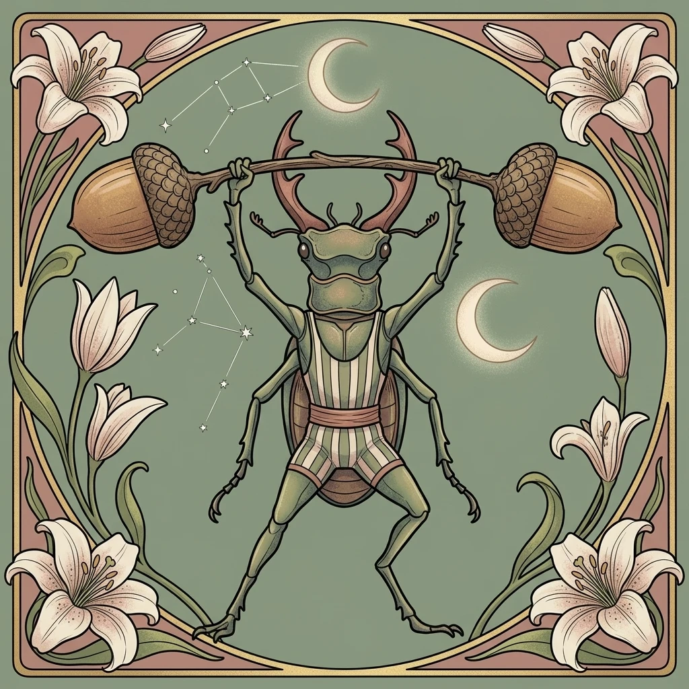
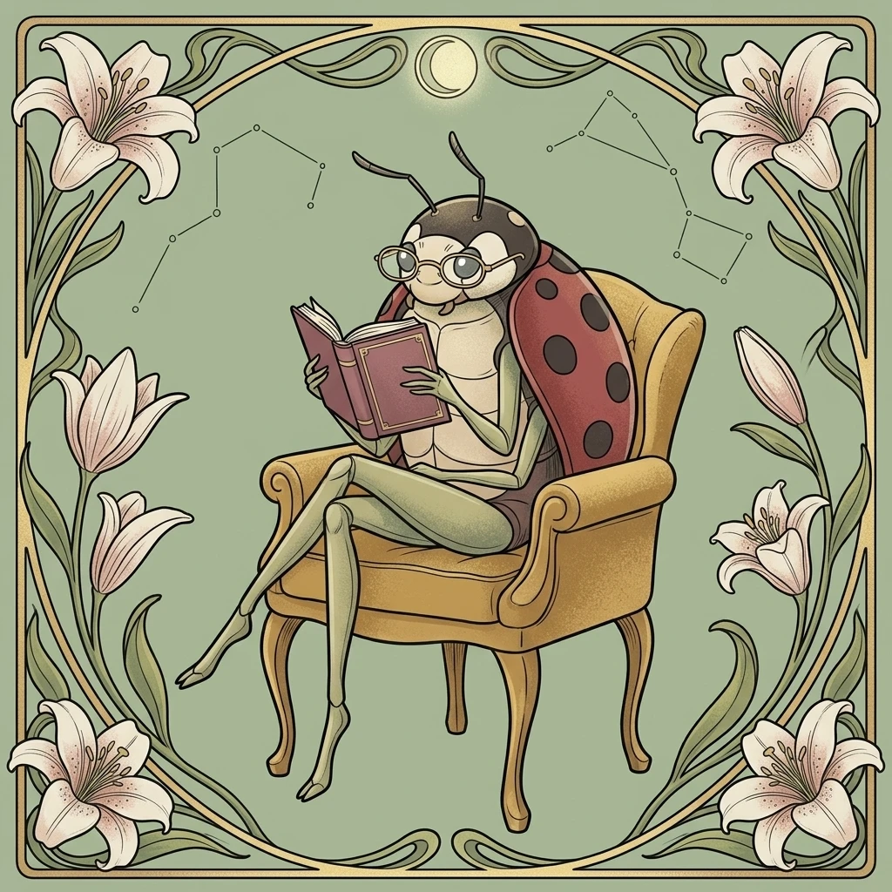
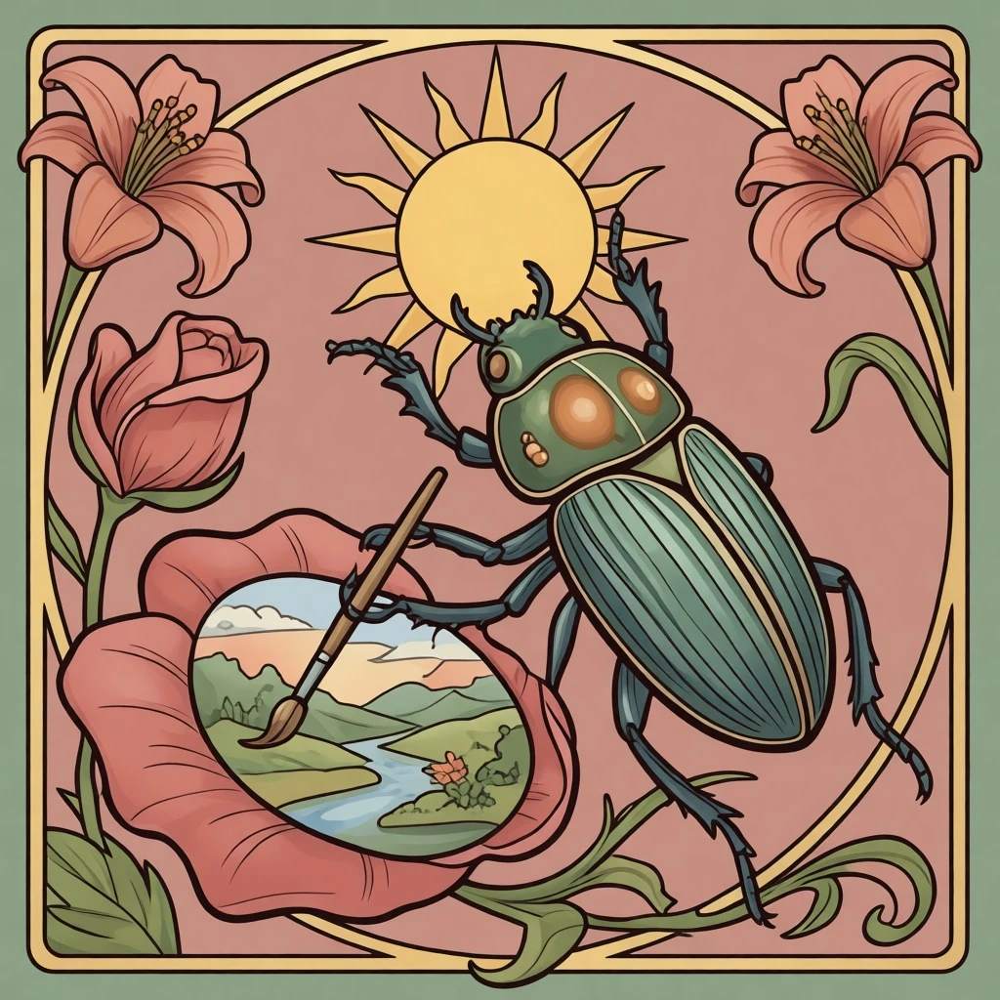
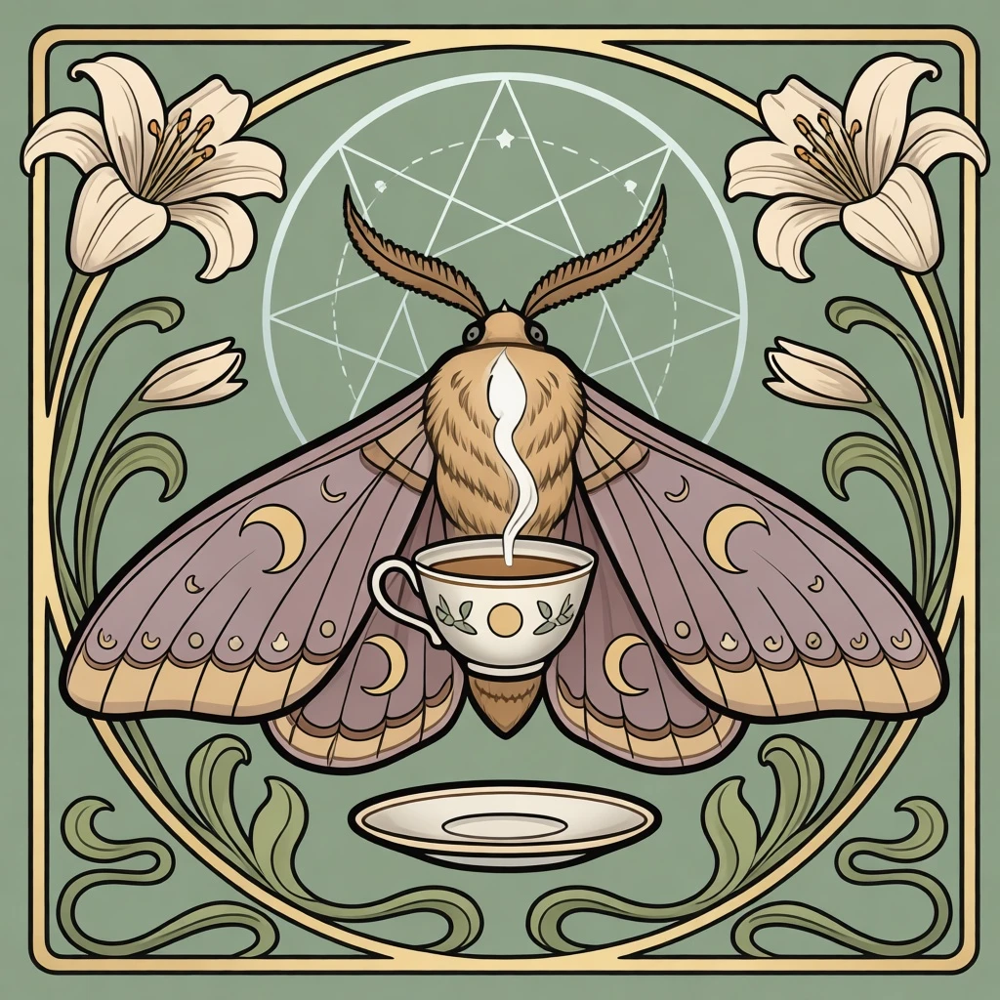

# Insects Art Nouveau

**[Open in the gallery →](https://artifisio.github.io/illustrations/insects-art-nouveau/)**

Anthropomorphic insects in a clean Art Nouveau frame — whiplash curves, lily borders, star charts, sage, dusty rose and ochre on grainy paper.

<p>
<a href="https://artifisio.github.io/illustrations/insects-art-nouveau/"></a>
<a href="https://artifisio.github.io/illustrations/insects-art-nouveau/"></a>
<a href="https://artifisio.github.io/illustrations/insects-art-nouveau/"></a>
<a href="https://artifisio.github.io/illustrations/insects-art-nouveau/"></a>
</p>

11 illustrations · SVG · WEBP · [CC-BY-4.0](https://creativecommons.org/licenses/by/4.0/)

## Install

```bash
npx artifisio add insects-art-nouveau
```

---

Part of the [Artifisio illustrations registry](../../README.md). Credit: Illustrations by Artifisio (https://artifisio.com); `add` writes it to `ATTRIBUTION.md`. `meta.json` lists every file with its sha256.
