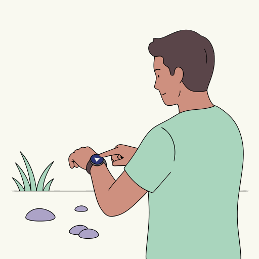
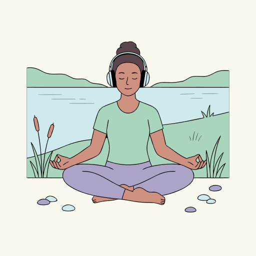
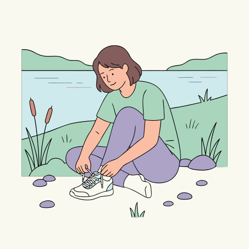

# Lakeside Yoga

**[Open in the gallery →](https://artifisio.github.io/illustrations/lakeside-yoga/)**

Elevate your wellness brand with a collection that captures the quiet harmony of a morning stretch by the water's edge. You will give your audience a moment of stillness and connection, turning every design into a restorative retreat from the busy world. These versatile scenes bring a sense of grounded tranquility to your social media posts, studio flyers, or personal journals.

<p>
<a href="https://artifisio.github.io/illustrations/lakeside-yoga/"></a>
<a href="https://artifisio.github.io/illustrations/lakeside-yoga/"></a>
<a href="https://artifisio.github.io/illustrations/lakeside-yoga/"></a>
<a href="https://artifisio.github.io/illustrations/lakeside-yoga/"></a>
</p>

18 illustrations · SVG · WEBP · 4 themeable colours · [CC-BY-4.0](https://creativecommons.org/licenses/by/4.0/)

## Install

```bash
npx artifisio add lakeside-yoga
```

Recolour at install time; themeable slots: `primary`, `secondary`, `accent`, `tertiary`.

```bash
npx artifisio add lakeside-yoga --colors "primary=#4A7CFF"
```

---

Part of the [Artifisio illustrations registry](../../README.md). Credit: Illustrations by Artifisio (https://artifisio.com); `add` writes it to `ATTRIBUTION.md`. `meta.json` lists every file with its sha256.
