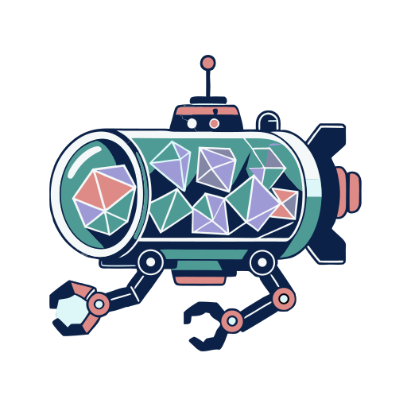
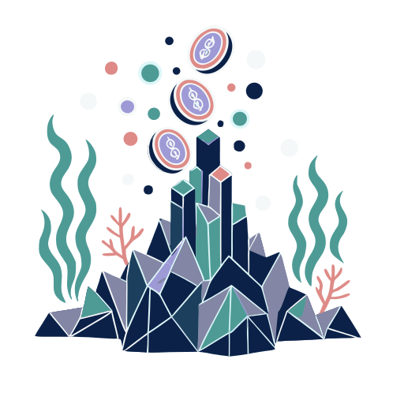

# Lumenaut

**[Open in the gallery →](https://artifisio.github.io/illustrations/lumenaut/)**

Plunge into the silent, glowing depths of the ocean and bring a sense of profound mystery to your creative projects. These scenes invite your audience to explore the unreachable, making them ideal for immersive world-building or evocative editorial designs. You will transform your work into a captivating journey through the dark, where every glimmer of light tells a story of wonder and survival.

<p>
<a href="https://artifisio.github.io/illustrations/lumenaut/"></a>
<a href="https://artifisio.github.io/illustrations/lumenaut/"></a>
<a href="https://artifisio.github.io/illustrations/lumenaut/"></a>
<a href="https://artifisio.github.io/illustrations/lumenaut/"></a>
</p>

35 illustrations · SVG · WEBP · 5 themeable colours · [CC-BY-4.0](https://creativecommons.org/licenses/by/4.0/)

## Install

```bash
npx artifisio add lumenaut
```

Recolour at install time; themeable slots: `dark-blue`, `teal`, `coral`, `lavender`, `steel`.

```bash
npx artifisio add lumenaut --colors "dark-blue=#4A7CFF"
```

---

Part of the [Artifisio illustrations registry](../../README.md). Credit: Illustrations by Artifisio (https://artifisio.com); `add` writes it to `ATTRIBUTION.md`. `meta.json` lists every file with its sha256.
