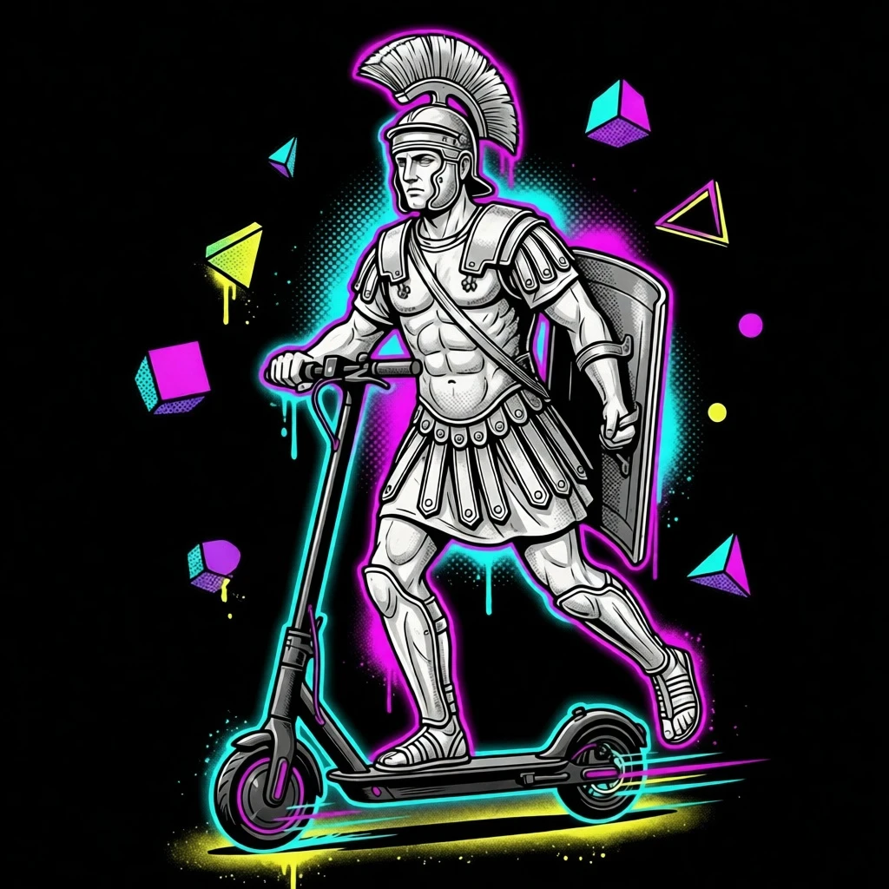
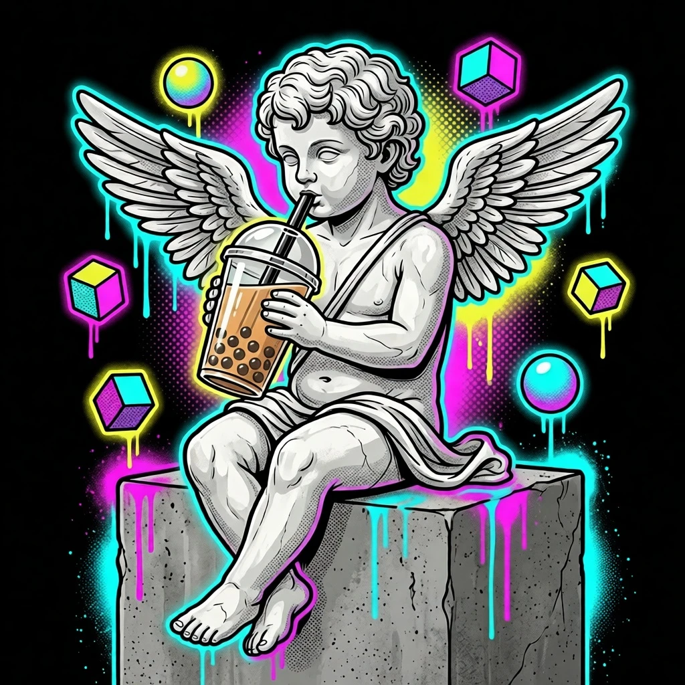
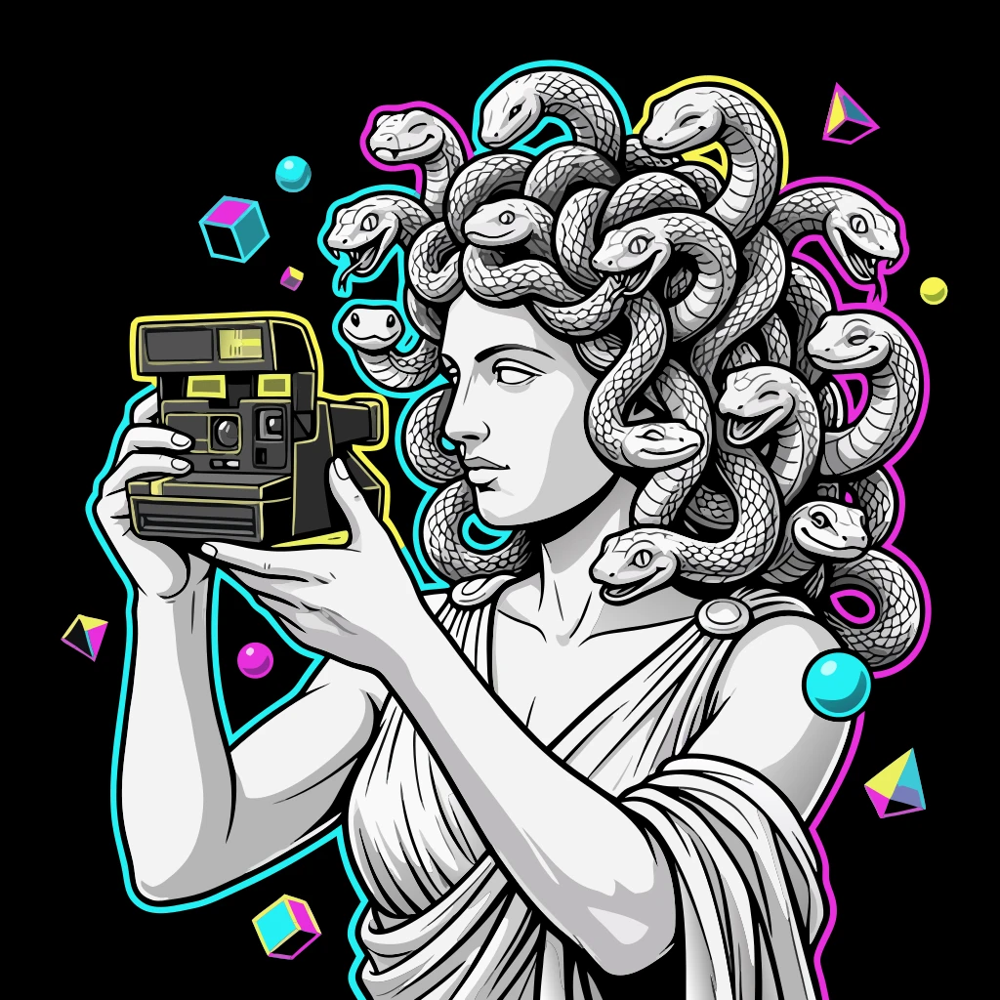

# neoclassic-street-art

**[Open in the gallery →](https://artifisio.github.io/illustrations/neoclassic-street-art/)**

Classical marble statues dropped into neon street art — heavy outlines, halftone, spray-paint drips, cyan and magenta on cracked concrete.

<p>
<a href="https://artifisio.github.io/illustrations/neoclassic-street-art/"></a>
<a href="https://artifisio.github.io/illustrations/neoclassic-street-art/"></a>
<a href="https://artifisio.github.io/illustrations/neoclassic-street-art/"></a>
<a href="https://artifisio.github.io/illustrations/neoclassic-street-art/"></a>
</p>

13 illustrations · SVG · WEBP · 3 themeable colours · [CC-BY-4.0](https://creativecommons.org/licenses/by/4.0/)

## Install

```bash
npx artifisio add neoclassic-street-art
```

Recolour at install time; themeable slots: `primary`, `secondary`, `accent`.

```bash
npx artifisio add neoclassic-street-art --colors "primary=#4A7CFF"
```

---

Part of the [Artifisio illustrations registry](../../README.md). Credit: Illustrations by Artifisio (https://artifisio.com); `add` writes it to `ATTRIBUTION.md`. `meta.json` lists every file with its sha256.
