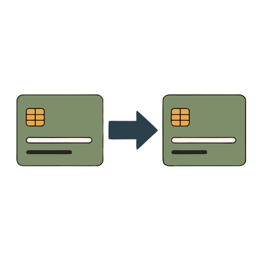
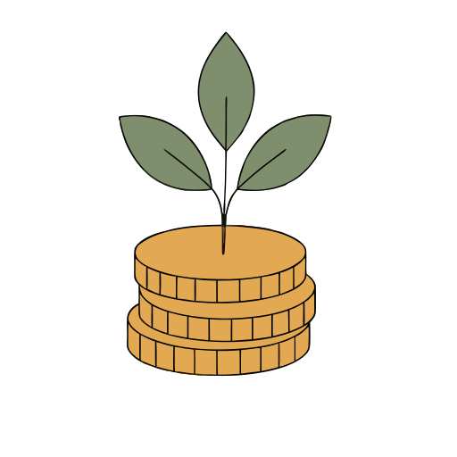

# Rooftop garden

**[Open in the gallery →](https://artifisio.github.io/illustrations/rooftop-garden/)**

Bring your vision of a greener future to life with illustrations that capture the peaceful harmony of urban farming and renewable energy. You can use these versatile scenes to inspire your audience to embrace a more sustainable lifestyle through your digital content and brand storytelling. Each piece offers a refreshing perspective on how we coexist with nature, making your environmental message feel both hopeful and impactful.

<p>
<a href="https://artifisio.github.io/illustrations/rooftop-garden/"></a>
<a href="https://artifisio.github.io/illustrations/rooftop-garden/"></a>
<a href="https://artifisio.github.io/illustrations/rooftop-garden/"></a>
<a href="https://artifisio.github.io/illustrations/rooftop-garden/"></a>
</p>

36 illustrations · SVG · WEBP · [CC-BY-4.0](https://creativecommons.org/licenses/by/4.0/)

## Install

```bash
npx artifisio add rooftop-garden
```

---

Part of the [Artifisio illustrations registry](../../README.md). Credit: Illustrations by Artifisio (https://artifisio.com); `add` writes it to `ATTRIBUTION.md`. `meta.json` lists every file with its sha256.
