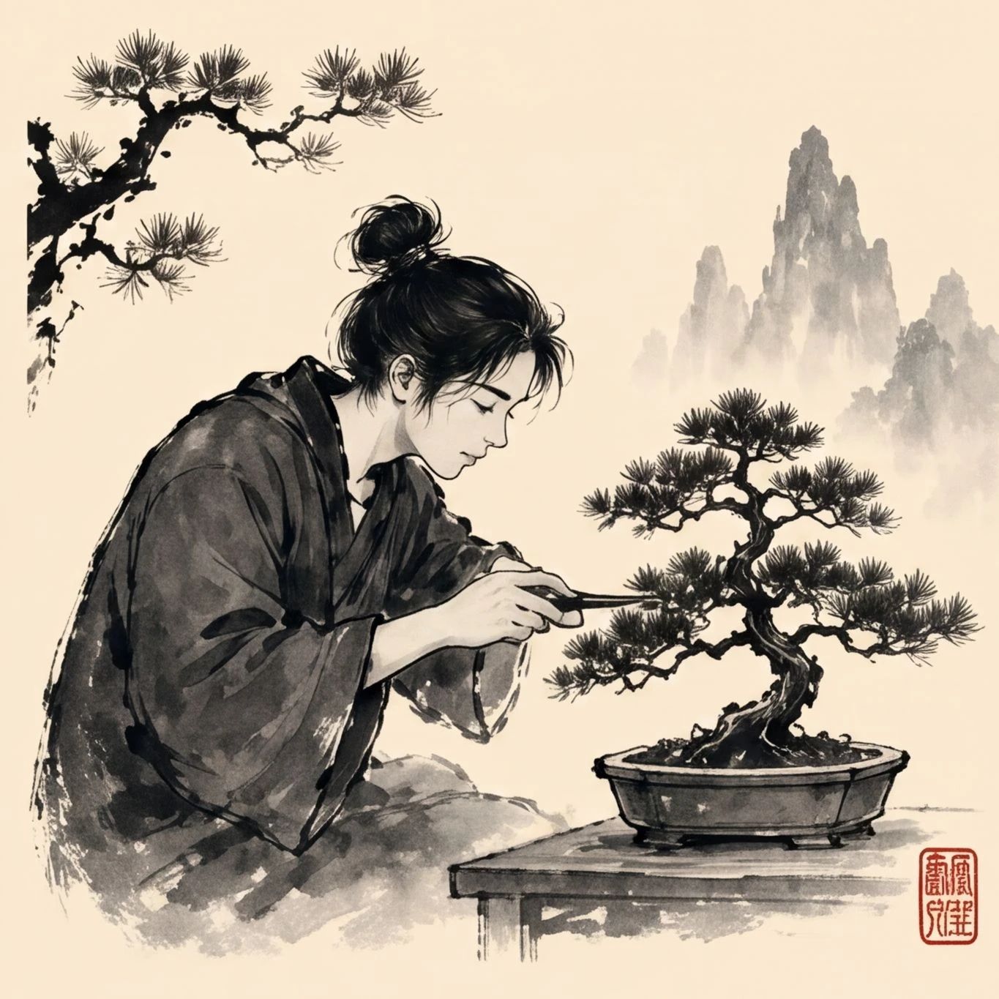
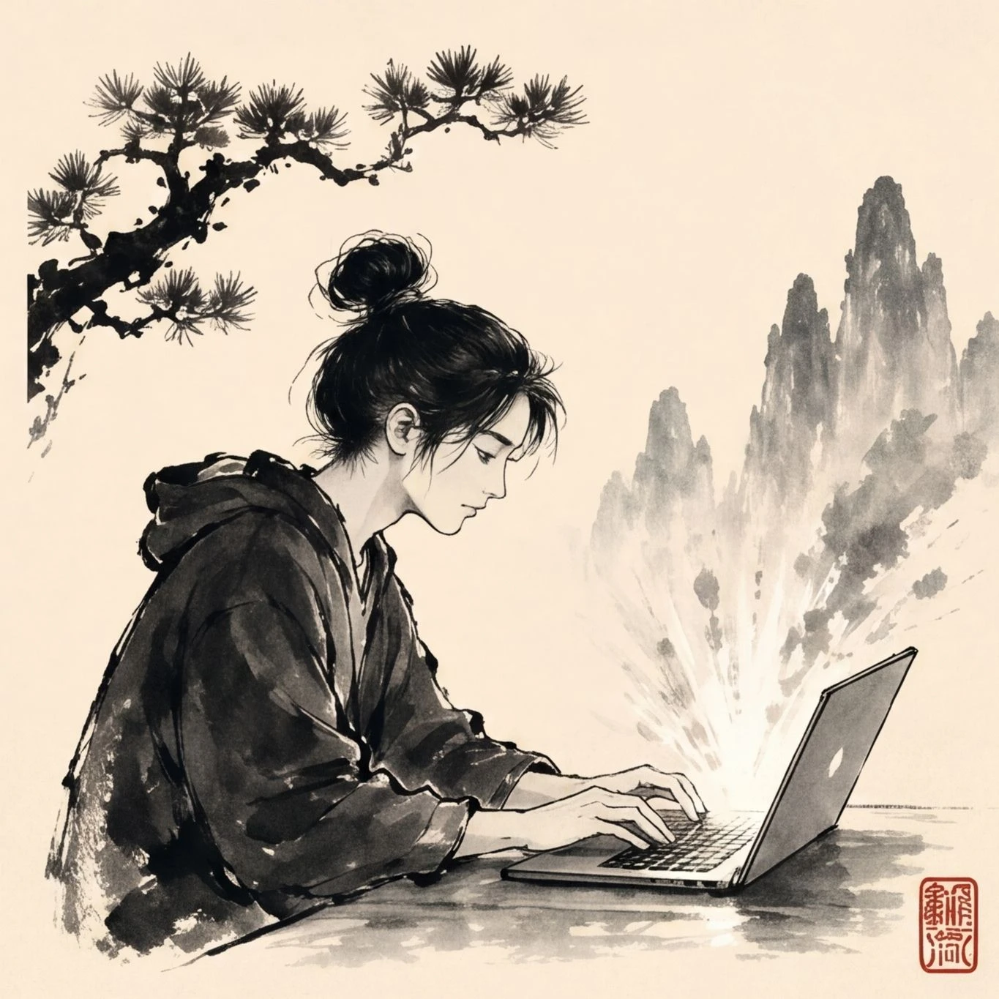

# Sumi-e Ink

**[Open in the gallery →](https://artifisio.github.io/illustrations/sumi-e-ink/)**

Infuse your designs with a sense of Zen-like calm and modern grace using these soulful portraits that capture a quiet, thoughtful strength. You will find these fluid illustrations perfect for adding a touch of timeless sophistication to your branding, social media, or personal storytelling. Each piece invites your audience to slow down and appreciate the poetic beauty found in a single, expressive moment.

<p>
<a href="https://artifisio.github.io/illustrations/sumi-e-ink/"></a>
<a href="https://artifisio.github.io/illustrations/sumi-e-ink/"></a>
<a href="https://artifisio.github.io/illustrations/sumi-e-ink/"></a>
<a href="https://artifisio.github.io/illustrations/sumi-e-ink/"></a>
</p>

9 illustrations · SVG · WEBP · [CC-BY-4.0](https://creativecommons.org/licenses/by/4.0/)

## Install

```bash
npx artifisio add sumi-e-ink
```

---

Part of the [Artifisio illustrations registry](../../README.md). Credit: Illustrations by Artifisio (https://artifisio.com); `add` writes it to `ATTRIBUTION.md`. `meta.json` lists every file with its sha256.
