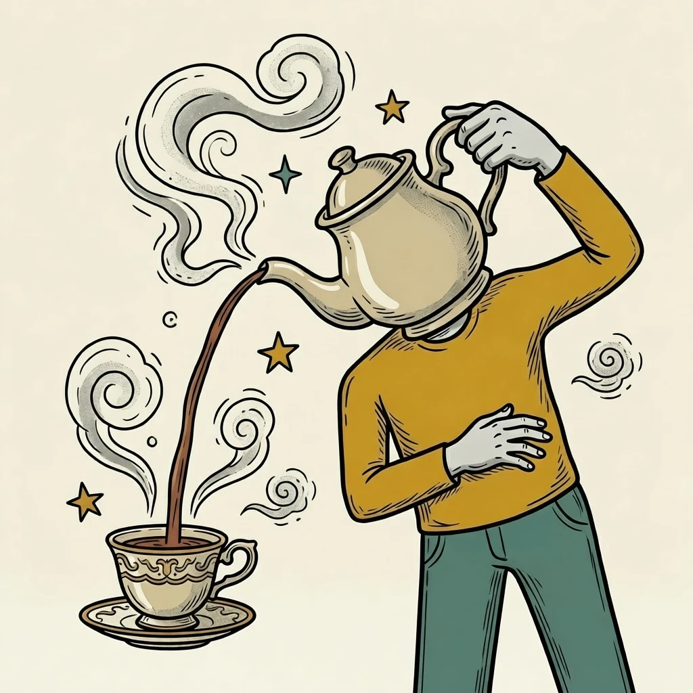
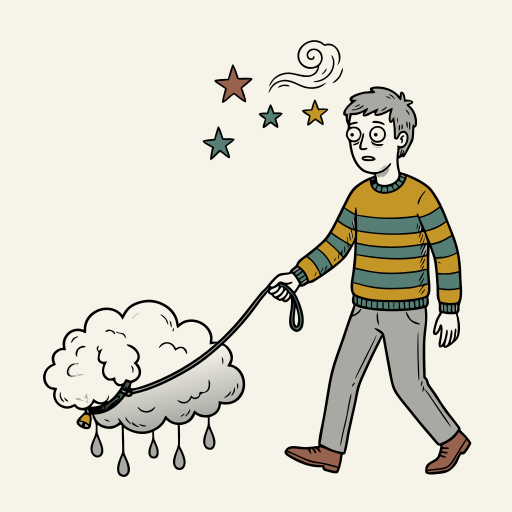
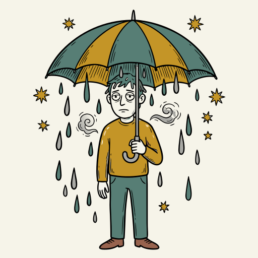
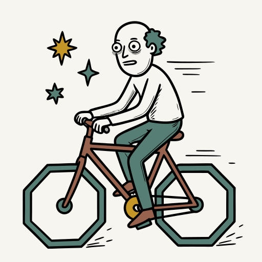

# Surreality

**[Open in the gallery →](https://artifisio.github.io/illustrations/surreality/)**

Place your audience in the heart of the impossible with these evocative scenes that blur the lines between dreams and reality. You can use these striking visuals to give your next project a sense of profound wonder and mystery that lingers in the viewer’s mind. Each piece offers a unique way to spark deep curiosity, making your work stand out as something truly unforgettable.

<p>
<a href="https://artifisio.github.io/illustrations/surreality/"></a>
<a href="https://artifisio.github.io/illustrations/surreality/"></a>
<a href="https://artifisio.github.io/illustrations/surreality/"></a>
<a href="https://artifisio.github.io/illustrations/surreality/"></a>
</p>

12 illustrations · SVG · WEBP · 3 themeable colours · [CC-BY-4.0](https://creativecommons.org/licenses/by/4.0/)

## Install

```bash
npx artifisio add surreality
```

Recolour at install time; themeable slots: `primary`, `secondary`, `accent`.

```bash
npx artifisio add surreality --colors "primary=#4A7CFF"
```

---

Part of the [Artifisio illustrations registry](../../README.md). Credit: Illustrations by Artifisio (https://artifisio.com); `add` writes it to `ATTRIBUTION.md`. `meta.json` lists every file with its sha256.
