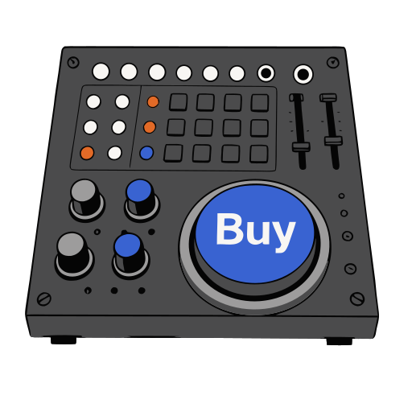
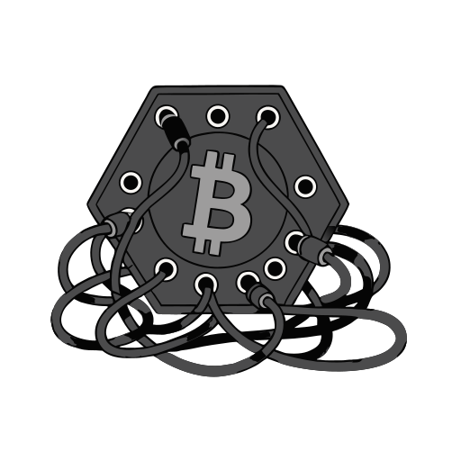

# Voltweave

**[Open in the gallery →](https://artifisio.github.io/illustrations/voltweave/)**

Immerse your audience in the rhythmic pulse of creativity with these vibrant scenes of a musician lost in his modular craft. You can use these soulful visuals to give your next music project or tech brand an undeniable sense of energy and human connection. It is the perfect way to make your digital space feel as alive and layered as a live performance.

<p>
<a href="https://artifisio.github.io/illustrations/voltweave/"></a>
<a href="https://artifisio.github.io/illustrations/voltweave/"></a>
<a href="https://artifisio.github.io/illustrations/voltweave/"></a>
<a href="https://artifisio.github.io/illustrations/voltweave/"></a>
</p>

33 illustrations · SVG · WEBP · 2 themeable colours · [CC-BY-4.0](https://creativecommons.org/licenses/by/4.0/)

## Install

```bash
npx artifisio add voltweave
```

Recolour at install time; themeable slots: `primary`, `accent`.

```bash
npx artifisio add voltweave --colors "primary=#4A7CFF"
```

---

Part of the [Artifisio illustrations registry](../../README.md). Credit: Illustrations by Artifisio (https://artifisio.com); `add` writes it to `ATTRIBUTION.md`. `meta.json` lists every file with its sha256.
